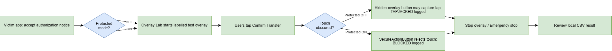

# TapSafe - Tapjacking Demonstrator & Defense Checker

> **Academic lab project / safe-by-default:** TapSafe is intended only for the two included demo apps, on an emulator or device owned by the student team or explicitly authorized for testing. The overlay is visibly labelled, user-started, and limited to the TapSafe Victim demo. It does not collect credentials, touch coordinates, screenshots, or personal data.

## Project overview

Tapjacking is an Android UI-redressing attack in which an interface is obscured so a user may activate a security-relevant control without understanding what the control does. Android distinguishes full and partial occlusion. This project demonstrates the concept with a harmless dummy action, then illustrates app-side mitigations.

## Attack category

Mobile Application Attack - Tapjacking.

## Modules

- `victim-app`: dummy app styled as a generic, fictional banking app ("JuneBank (Demo)" - not a real institution) containing a local test action ("Confirm Transfer"), authorization notice, vulnerable/protected modes, touch filtering, and local CSV event logging.
- `overlay-demo`: separate app that requests the Android overlay permission, displays a clearly identified full-screen test banner, positions a small touchable hidden button over the victim app's "Confirm Transfer" button (the actual tapjacking mechanism under study), and launches only the TapSafe Victim package.

## Architecture

```text
TapSafe repository
├── victim-app       (package: my.edu.unikl.tapsafe.victim)
│   ├── MainActivity
│   ├── SecureActionButton
│   └── ResultStore
├── overlay-demo     (package: my.edu.unikl.tapsafe.overlay)
│   └── MainActivity
├── README.md
└── LICENSE
```

### How the demo flows



## Requirements

- Android Studio with Android SDK Platform 36 installed.
- JDK 17.
- Android Emulator or an Android device owned/authorized by your team.
- A test matrix including Android 10 (API 29) and Android 12 or newer (API 31+) is recommended to observe platform-version differences.

The project pins Android Gradle Plugin 8.11.1 and Kotlin Android plugin 2.2.20. The Gradle wrapper distribution is set to Gradle 8.13. If your Android Studio installation recommends a compatible newer patch, update and test the version consistently across the team.

## Installation

### Open and build

1. Extract the repository.
2. Open the `TapSafe_Project` folder in Android Studio.
3. Set Gradle JDK to JDK 17 (Settings > Build, Execution, Deployment > Build Tools > Gradle).
4. Install Android SDK Platform 36 and accept SDK licences.
5. Allow Gradle sync to complete.
6. Build each module: `victim-app` and `overlay-demo`.

The included `gradlew` / `gradlew.bat` bootstrap launchers download the pinned Gradle 8.13 distribution on first run. They are small project bootstrap scripts rather than the standard generated Gradle Wrapper JAR scripts. If your lecturer requires the standard wrapper, run `gradle wrapper --gradle-version 8.13` from a machine with Gradle installed and commit the generated wrapper JAR and scripts.

### Install both apps on an emulator or device

Build and install both debug variants from Android Studio, or use ADB after building:

```bash
adb install -r victim-app/build/outputs/apk/debug/victim-app-debug.apk
adb install -r overlay-demo/build/outputs/apk/debug/overlay-demo-debug.apk
```

## Usage

1. Open **TapSafe Victim Lab** (JuneBank (Demo)) and accept the on-screen local-lab authorization notice.
2. Choose a test mode: protected mode OFF for the baseline dummy test, or ON to enable app-side filtering.
3. Open **TapSafe Overlay Lab**.
4. Grant the overlay permission manually in Android Settings when requested.
5. Press **Start lab overlay over victim app**. The hidden button's vertical position is a fixed value (`HIDDEN_BUTTON_OFFSET_DP` in `overlay-demo/MainActivity.kt`) - if it doesn't line up with the victim app's "Confirm Transfer" button on your device/emulator, edit that constant and rebuild.
6. In the victim app, tap **Confirm Transfer**. With protected mode OFF, the tap may be captured by the hidden overlay button instead (status line reports "TAPJACKED..."). Android may also block overlay touch pass-through, especially on newer releases - that is an expected security outcome and must be recorded honestly either way.
7. Return to TapSafe Overlay Lab and press **Stop overlay now**.
8. In TapSafe Victim Lab, enable protected mode and repeat the test; the protected button should reject the obscured touch instead.
9. View local test results. The CSV is stored in the victim app's private internal files directory as `tapsafe-lab-results.csv`.

### Usage examples

Pull the local result log from a debug build on your own emulator/device:

```bash
adb shell run-as my.edu.unikl.tapsafe.victim cat files/tapsafe-lab-results.csv
```

Emergency stop from the command line (force-stops both lab apps):

```bash
adb shell am force-stop my.edu.unikl.tapsafe.overlay
adb shell am force-stop my.edu.unikl.tapsafe.victim
```

Typical outcomes recorded in the log:

| Scenario | Protected mode | Log entry |
|---|---|---|
| Normal tap on Confirm Transfer | OFF or ON | `ACTION_ACCEPTED` |
| Overlay's hidden button captures the tap | OFF | `OVERLAY_INTERCEPTED_TAP` (status line shows "TAPJACKED...") |
| Partially obscured touch rejected | ON | `PARTIAL_OCCLUSION_BLOCKED` (status line shows "BLOCKED...") |
| Emergency stop pressed | any | `EMERGENCY_STOP` |

## Security controls

- Explicit consent notice references Malaysia's Computer Crimes Act 1997 and restricts the authorized scope to this lab.
- No real transaction, credentials, user input or touch coordinates are collected.
- Overlay must be manually started after permission is granted.
- Overlay is clearly labelled as a lab test layer.
- App-side filtering uses `filterTouchesWhenObscured` for full occlusion and checks `FLAG_WINDOW_IS_PARTIALLY_OBSCURED` for partial occlusion.
- Emergency stop turns on protected mode and sends a package-scoped stop broadcast to the companion Overlay Lab app when it is running.
- Local results can be cleared from the victim app.

## Attack lifecycle mapping

| Lifecycle step | TapSafe demonstration | Evidence to capture |
|---|---|---|
| Preparation | User installs both lab apps and authorizes local scope | App screens and consent |
| Overlay setup | User explicitly grants overlay permission and starts the visible layer | Permission and overlay screenshot |
| Obscuring | Clearly labelled overlay appears over the dummy app | Screenshot of test layer |
| Interaction attempt | User taps only the harmless dummy action | Actual emulator result |
| Detection / prevention | Protected mode filters obscured touch events | Result log and device/API version |
| Reporting / cleanup | Local event log is reviewed; overlay is stopped | CSV extract and stop confirmation |

## Ethical considerations

- **Authorization first:** the victim app shows an authorization notice on launch and the tool is limited to the two included lab packages.
- **Safe defaults:** the only target is the bundled dummy app, on a local emulator or an owned device. Protected mode and the stop controls are always one tap away.
- **Visible by design:** the overlay is clearly labelled as a lab test layer and is never started automatically.
- **Harmless action only:** the "Confirm Transfer" action is a dummy that moves no money and calls no network service.
- **Data minimisation:** no credentials, touch coordinates, screenshots, or personal data are collected. Logs stay on the device in app-private storage and can be cleared in-app.
- **Fictional branding:** "JuneBank (Demo)" is not a real institution and mimics no real bank.

## Legal disclaimer

This software is provided for educational use in the UniKL Ethical Hacking course only. Unauthorized access to, or interference with, computer systems is an offence under Malaysia's **Computer Crimes Act 1997**. Use TapSafe only on devices you own or have explicit written permission to test. The authors accept no liability for misuse. The app displays this notice on startup and requires the user to confirm authorization before the lab controls are available.

## Rules of Engagement (RoE)

- **Authorized scope:** `my.edu.unikl.tapsafe.victim` and `my.edu.unikl.tapsafe.overlay` only.
- **Environment:** local Android emulators or devices owned by the team or covered by explicit written authorization.
- **Time window:** only scheduled coursework lab sessions agreed by the group and lecturer.
- **Permitted techniques:** visible overlay demonstration, dummy-button interaction, app-side obscured-touch checks, platform mitigation comparison, local logging.
- **Prohibited actions:** testing banking or third-party applications, impersonating a real service, hiding the test overlay, credential capture, data exfiltration, persistence, bypassing Android security protections, or testing any device without authorization.
- **Emergency stop:** press Stop overlay in TapSafe Overlay Lab; use the victim app's Emergency stop / safe reset; if necessary, force-stop both lab apps from Android Settings.
- **Data handling:** keep only non-sensitive test event logs in app-private storage. Clear logs after the report has been completed.

## Responsible disclosure

This coursework tool is not intended to test third-party products. If a separate vulnerability is discovered accidentally, stop testing, preserve only the minimum non-sensitive evidence, do not access or disclose other people's data, and report it privately to the system owner or the institution's designated security contact. Obtain written authorization before any further validation.

- **Who:** the course lecturer first; for any real third-party product, its vendor's security contact (e.g. `security@` address or published disclosure programme).
- **When:** immediately after discovering the issue, before sharing details with anyone else.
- **How:** private written report with product/version, steps to reproduce, impact, and minimal non-sensitive evidence. Do not publish until the owner has had reasonable time to fix it.

## Limitations

- Results depend on Android version, device vendor, overlay type, opacity, and system policy.
- Android 12+ includes protections against untrusted overlay touch pass-through. A successful pass-through is not guaranteed and should not be forced by disabling OS security.
- The demo uses one harmless dummy action inside a fictional, generic bank-style UI ("JuneBank (Demo)"); it does not model any real bank, permission-grant, or production workflow.
- The hidden overlay button's position is a fixed `HIDDEN_BUTTON_OFFSET_DP` constant in code; it is not guaranteed to align across every device/emulator/screen size without editing that value and rebuilding, and this is expected - record what value you used.
- The CSV log records local test outcomes only. It does not independently prove whether an OS-level block occurred before the app received an event.
- `SYSTEM_ALERT_WINDOW` is a sensitive permission and must be granted manually by the user.

## References

- Android Developers, *Tapjacking*: https://developer.android.com/privacy-and-security/risks/tapjacking
- Android Developers, *View API*: https://developer.android.com/reference/android/view/View
- Android Developers, *Window API*: https://developer.android.com/reference/android/view/Window
- Malaysian Computer Crimes Act 1997

## Contributors

1. Fathurrahim bin Fadzil Rizal
2. Fahim Syamil bin Mohd Alfahmi
3. Aliya Natasha
4. ⁠Farah Fatini binti Hazlin Shah
